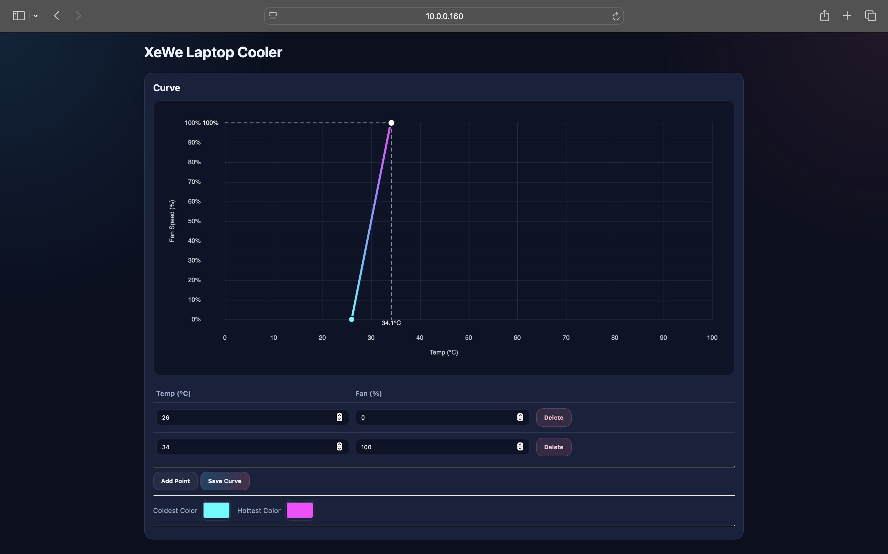

# xewe-chill-os

Firmware for a DIY laptop cooling pad on an ESP32-C3, -C6 or -S3, built on [XeWe OS](https://github.com/xewe-labs/xewe-os). An infrared sensor reads the laptop's underside, two PC fans follow a temperature curve that you set, and an LED strip shows the temperature as a colour.

<p align="center"></p>

## Problem

- A fixed-speed pad makes the same noise whether the laptop is idle or under load, and turning the fans down means remembering to turn them up.
- You cannot see how hot the laptop's underside is without a monitoring tool running on it.

## Solution

The pad reads the laptop's temperature itself and sets its own fan speed. A curve of up to 16 points maps temperature to speed, and the strip shows the same curve as a colour from cold to hot. Three ideas carry it:

- An MLX90614 reads the underside every 500 ms, and both fans follow the curve once a second.
- When no reading arrives, the fans run at the curve's last point (100 % by default) and the strip shows the hot colour.
- The curve, colours, fans, pins and strip settings live in flash, and you change them from `http://<device-ip>/` or the serial console without rebuilding.

## See it

```text
$fan curve set 30:20,40:60,50:100
$fan temp 35
Temperature set to 35.00 C, curve target 40 %.
```

The next sensor reading replaces the test value within 0.5 s.

## Why not a fixed-speed pad

| | Fixed-speed pad | xewe-chill-os |
|---|---|---|
| Fan speed | one setting, chosen by hand | follows the laptop's temperature |
| Temperature | not shown | strip colour, web page, `$mlx90614 read` |
| Sensor failure | not applicable | fans to the last point, strip to the hot colour |
| Build | bought finished | an ESP32, two PC fans, an MLX90614 and a WS2812B strip that you wire |

## Install

You need Python 3.11 or newer and git. Everything installs into the project folder and `~/.xewe-os`, so you never need sudo.

```sh
git clone https://github.com/xewe-labs/xewe-chill-os && cd xewe-chill-os
./setup.sh
./run.sh --chip c3
```

The parts and pins are in [doc/WIRING.md](doc/WIRING.md). The console then asks the questions in [doc/FIRST_BOOT.md](doc/FIRST_BOOT.md).

## Usage

Edit the fan curve in the console or on the web page at `http://<device-ip>/` ([doc/FAN_CURVE.md](doc/FAN_CURVE.md)):

```text
$fan curve add 45 80
$fan curve remove 45
$fan curve list
```

Set the strip's cold and hot colours, or hand the strip to the `$led` commands:

```text
$pad set_cold 0000FF
$pad set_hot FF4000
$pad lights off
```

`$help` lists every group; the arguments are in [doc/COMMANDS.md](doc/COMMANDS.md).

## Status

Version 1.0.0 builds for ESP32-C3, -C6 and -S3. It has not yet run on the assembled pad; [tests/MANUAL.md](tests/MANUAL.md) is the first test on real hardware. The strip has one data pin, fixed at build time, and the device cannot start its own Wi-Fi access point. If something fails, see [doc/TROUBLESHOOTING.md](doc/TROUBLESHOOTING.md).

---

## Development

```sh
./setup.sh
build/tools/.venv/bin/python -m xewe build --chip c3     # or --all-chips
build/tools/.venv/bin/python -m xewe test --unit-only
build/tools/.venv/bin/python -m xewe format
build/tools/.venv/bin/python -m xewe brand-lint .
```

CI runs from [.github/workflows/ci.yml](.github/workflows/ci.yml). The release procedure is in [scripts/README.md](scripts/README.md). Setup and the `xewe` tools are in [doc/XEWE_OS_ECOSYSTEM.md](doc/XEWE_OS_ECOSYSTEM.md), tests in [doc/TESTING.md](doc/TESTING.md).

## Layout

- [src/](src/README.md) holds the pad's three modules: [Fan](src/Fan/README.md), [Mlx90614](src/Mlx90614/README.md) and [PadWeb](src/PadWeb/README.md).
- [tests/](tests/README.md) holds the unit tests, the board tests and the manual hardware test.
- [scripts/](scripts/README.md) holds the release script.
- [doc/](doc/) holds the guides.
- `xewe-chill-os.ino` is the sketch, `Config.h` the configuration, `xewe.toml` the manifest and `setup.sh` the installer.

## License

GPL-3.0-only, see [LICENSE.txt](LICENSE.txt).
